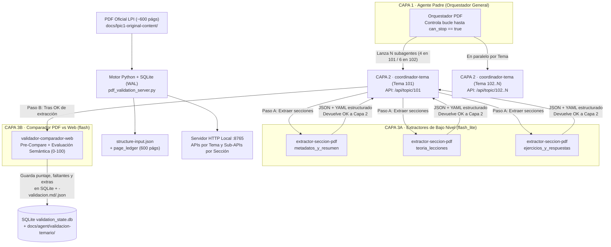

# /validar-temario-pdf · Validación Masiva Autónoma PDF Oficial vs. Aplicación Web (3 Capas + SQLite + Micro-APIs Python)

Esta skill ejecuta el proceso completo de extracción estructurada y auditoría comparativa entre los manuales oficiales de LPI en `docs/lpic1-original-content/` (`LPI-Learning-Material-101-500-es.pdf` de 571 páginas y `LPI-Learning-Material-102-500-es.pdf` de 594 páginas) y la teoría/práctica desarrollada en la web (`content-src/`).

---

## 0. Principios de Diseño y Ahorro Extremo de Tokens

1. **Prohibido volcar el PDF crudo al contexto del LLM**: Ningún agente ni subagente lee las ~600 páginas del PDF directamente con herramientas de lectura de texto. Toda extracción tipográfica (fuentes monoespaciadas, negritas, cursivas, tamaños de título, bloques de código, ejercicios y respuestas) la ejecuta determinísticamente en milisegundos el motor Python con `PyMuPDF` ([pdf_validation_server.py](./scripts/pdf_validation_server.py)).
2. **Servidor Python con APIs por Tema y Sub-APIs por Sección**:
   - Al analizar un PDF, el motor detecta sus **Temas** (`4` en el 101-500; `6` en el 102-500), sus **Subtemas** (`23` en el 101-500; `19` en el 102-500) y divide cada subtema en **3 Sub-APIs internas de sección**:
     - `metadatos_y_resumen`: Portada del objetivo, Importancia (peso), *Áreas de conocimiento clave*, *Lista parcial de archivos, términos y utilidades* y *Resumen*.
     - `teoria_lecciones`: Desarrollo teórico de todas las lecciones del subtema, comandos, sintaxis, flags/opciones, rutas, variables y términos definidos.
     - `ejercicios_y_respuestas`: Enunciados de *Ejercicios Guiados*, *Ejercicios Exploratorios* y sus *Respuestas Oficiales*.
3. **Control de Estado Atómico en SQLite (`validation_state.db`)**:
   - La base de datos local en `content-src/_extract/validacion-masiva/validation_state.db` registra en `page_ledger` cada una de las ~600 páginas del PDF y el estado (`PENDING`, `OK`, `VALIDATED`) de cada sección, subtema y tema.
   - **Regla de No-Parada**: El Orquestador (Capa 1) **no puede detenerse** hasta que el endpoint `progress` devuelva `"can_stop": true` (`pending_curriculum_pages == 0` y todos los subtemas con `comparison_status == "OK"`).
4. **Subagentes Económicos (`flash_lite` / `flash`)**:
   - Los subagentes de bajo nivel (**Capa 3A** de extracción y **Capa 3B** de comparación) se invocan siempre con `Model: 'flash_lite'` o `Model: 'flash'`, recibiendo únicamente el segmento pre-procesado por su Sub-API.

---

## 1. Arquitectura de 3 Capas y Flujo de Datos



---

## 2. Procedimiento Paso a Paso (Ejecución Autónoma)

### Paso 1: Inicializar Estructura del PDF, Base de Datos SQLite y Servidor Python

1. Determina qué PDF se va a validar:
   - Examen 101: `docs/lpic1-original-content/LPI-Learning-Material-101-500-es.pdf` (`exam_id = 101-500`, 571 páginas, 4 temas, 23 subtemas, 69 secciones).
   - Examen 102: `docs/lpic1-original-content/LPI-Learning-Material-102-500-es.pdf` (`exam_id = 102-500`, 594 páginas, 6 temas, 19 subtemas, 57 secciones).
2. Ejecuta el análisis estructural inicial y creación de `structure-input.json` + tablas SQLite:
   ```powershell
   python .agents/skills/validar-temario-pdf/scripts/pdf_validation_server.py init --pdf "docs/lpic1-original-content/LPI-Learning-Material-101-500-es.pdf"
   ```
3. Levanta en segundo plano (`IsDaemon: true`) el servidor Python de APIs por Tema y Sub-APIs por Sección:
   ```powershell
   python .agents/skills/validar-temario-pdf/scripts/pdf_validation_server.py serve --port 8765
   ```
4. Verifica que el fichero general de estructura se ha guardado en:
   `content-src/_extract/validacion-masiva/<exam_id>/structure-input.json`.

---

### Paso 2: Registrar las Definiciones de Subagentes (`define_subagent`)

Lee las especificaciones completas de System Prompts en [references/system-prompts-capas.md](./references/system-prompts-capas.md) y registra con `define_subagent` los 3 tipos de subagentes especializados:

1. **`coordinador-tema`** (Capa 2 — `EnableWriteTools: true`, `EnableSubagentTools: true`): Coordina un Tema completo a través de `/api/topic/<topic_id>`.
2. **`extractor-seccion-pdf`** (Capa 3A — `EnableWriteTools: true`, `EnableSubagentTools: false`): Extrae una sección concreta (`metadatos_y_resumen`, `teoria_lecciones`, `ejercicios_y_respuestas`) a JSON y YAML usando PyMuPDF determinista y devuelve `OK <subtopic_id>/<section_slug>`.
3. **`validador-comparador-web`** (Capa 3B — `EnableWriteTools: true`, `EnableSubagentTools: false`): Cruza los JSON/YAML extraídos del PDF con la web (`lessons`, `labs`, `commands.yaml`, `glossary.yaml`, `questions`), puntúa de `0` a `100` y guarda el informe detallado de qué falta, qué sobra y qué contradice al manual.

---

### Paso 3: Lanzar los Subagentes de Capa 2 por Tema (`invoke_subagent`)

1. Consulta los temas detectados en `structure-input.json` (por ejemplo, `101`, `102`, `103`, `104` para `101-500`).
2. Lanza un subagente `coordinador-tema` (`Model: 'flash'`) por cada Tema, pasándole su endpoint `/api/topic/<topic_id>` y la lista de sus subtemas (plantilla exacta en [references/system-prompts-capas.md](./references/system-prompts-capas.md)).
3. Cada `coordinador-tema`:
   - Invoca a los subagentes de bajo nivel `extractor-seccion-pdf` (`Model: 'flash_lite'`) para las secciones de cada subtema.
   - En cuanto las 3 secciones de un subtema devuelven `OK`, invoca al subagente `validador-comparador-web` (`Model: 'flash'`) para puntuar ese subtema y generar `docs/agent/validacion-temario/<exam_id>/subtemas/<subtopic_id>-validacion.{json,md}`.
   - Al completar todos los subtemas de su tema, notifica `TOPIC_OK <topic_id>` al Orquestador.

---

### Paso 4: Bucle de Control en SQLite hasta Procesar las ~600 Páginas (`can_stop == true`)

Cada vez que terminen los coordinadores de tema (o para comprobar el estado en cualquier momento / reanudar una sesión), el Orquestador ejecuta:

```powershell
python .agents/skills/validar-temario-pdf/scripts/pdf_validation_server.py progress --exam 101-500
```

- **Verifica**:
  - `pending_curriculum_pages`: Debe ser `0` (`pages_completion_pct: 100.0`).
  - `can_stop`: Debe ser `true`.
- Si algún subtema o sección quedó en `PENDING` (por ejemplo, si un subagente falló o se interrumpió), relanza únicamente el subagente correspondiente a ese subtema pendiente consultando la base de datos SQLite. **Prohibido detenerse mientras `can_stop` sea `false`**.

---

### Paso 5: Generación del Informe Maestro Consolidado

Cuando `can_stop` sea `true` (las ~600 páginas del PDF han sido procesadas y todos los subtemas están validados y puntuados):

1. Genera el informe maestro consolidado:
   ```powershell
   python .agents/skills/validar-temario-pdf/scripts/pdf_validation_server.py master-report --exam 101-500
   ```
2. Esto produce:
   - `docs/agent/validacion-temario/<exam_id>/00-RESUMEN-VALIDACION-TEMARIO.md`
   - `docs/agent/validacion-temario/<exam_id>/00-resumen-validacion-temario.json`
   - Un fichero JSON y otro Markdown por cada subtema en `docs/agent/validacion-temario/<exam_id>/subtemas/<subtopic_id>-validacion.{json,md}`.
3. Detén el proceso daemon del servidor Python (`manage_task` con `Action: 'kill'`) y presenta al usuario la tabla resumen con los puntajes por tema y subtema, los principales elementos faltantes y las adiciones extra detectadas.

---

## 3. Referencias de la Skill (Carga Progresiva)

- **[references/system-prompts-capas.md](./references/system-prompts-capas.md)**: System Prompts completos y plantillas de `define_subagent` / `invoke_subagent` para Capa 1, Capa 2, Capa 3A y Capa 3B.
- **[references/esquemas-datos-y-api.md](./references/esquemas-datos-y-api.md)**: Esquema de las 6 tablas SQLite (`validation_state.db`), endpoints HTTP del servidor Python, rúbrica de puntuación `0–100` y estructura de informes.
- **[scripts/pdf_validation_server.py](./scripts/pdf_validation_server.py)**: Servidor HTTP multihilo + motor SQLite WAL + extractor PyMuPDF + pre-comparador determinista.
