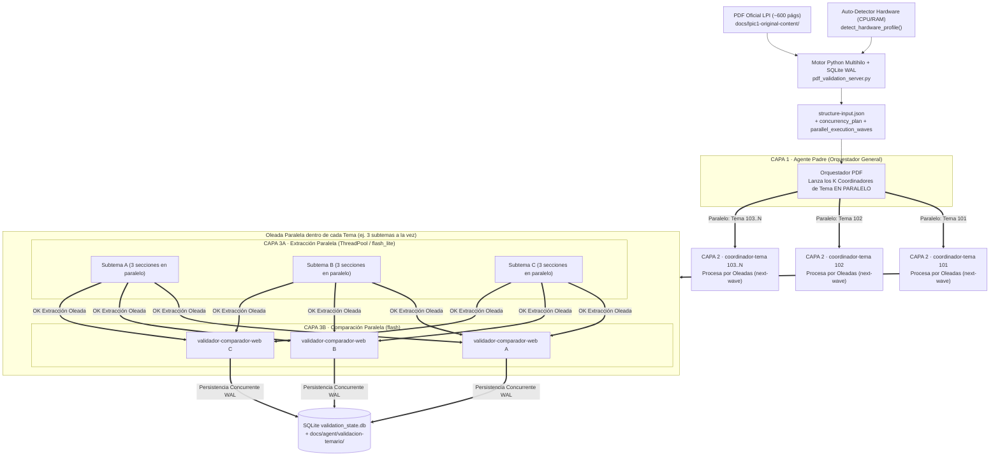

# /validar-temario-pdf · Validación Masiva Autónoma en Paralelo (Hardware-Aware + 3 Capas + SQLite WAL + Micro-APIs Python)

Esta skill ejecuta el proceso completo de extracción estructurada y auditoría comparativa en **paralelo controlado por hardware** entre los manuales oficiales de LPI en `docs/lpic1-original-content/` (`LPI-Learning-Material-101-500-es.pdf` de 571 páginas y `LPI-Learning-Material-102-500-es.pdf` de 594 páginas) y la teoría/práctica desarrollada en la web (`content-src/`).

---

## 0. Principios de Diseño: Paralelismo Adaptado al Hardware + Ahorro Extremo de Tokens

1. **Auto-Detección de Hardware y Planificador de Concurrencia (`concurrency_plan`)**:
   - Al ejecutar `init`, el motor Python ([pdf_validation_server.py](./scripts/pdf_validation_server.py)) inspecciona los núcleos lógicos de CPU (`os.cpu_count()`) y la memoria RAM física total y libre (`GlobalMemoryStatusEx` en Windows) y calcula automáticamente:
     - `python_thread_pool_workers`: Hilos del `ThreadPoolExecutor` en Python (ej. **14 hilos paralelos** en una máquina de 16 CPUs y 32 GB RAM).
     - `max_parallel_layer2_topic_agents`: Cuántos subagentes `coordinador-tema` (Capa 2) se lanzan **en paralelo en el mismo turno** (ej. **los 4 temas a la vez** en `101-500`, o **los 6 temas a la vez** en `102-500`).
     - `subtopics_per_wave_per_topic` y `max_parallel_layer3_subagents_per_topic`: Límite de subtemas/subagentes de Capa 3 simultáneos por Tema en cada oleada (`wave_index`), garantizando que **nunca se ejecute de forma secuencial 1 a 1**, pero sin desbordar la RAM ni los límites de cuota (ej. **3 subtemas en paralelo por Tema × 4 Temas = 12 subagentes concurrentes**).
2. **Prohibido volcar el PDF crudo al contexto del LLM**:
   - Ningún agente ni subagente lee las ~600 páginas del PDF directamente. Toda extracción tipográfica la ejecuta determinísticamente el motor Python multihilo con `PyMuPDF` (cada hilo abre su propio descriptor de documento para paralelismo real sin bloqueos GIL).
3. **Servidor Python Multihilo con APIs por Tema, Sub-APIs por Sección y Endpoints de Oleada (`Wave`)**:
   - Cada Tema tiene su API (`/api/topic/<topic_id>`) con planificador de siguiente oleada (`/api/topic/<topic_id>/next-wave`) y ejecución paralela de oleada (`/api/topic/<topic_id>/extract-wave` y `/api/topic/<topic_id>/pre-compare-wave`).
   - Cada Subtema se divide en **3 Sub-APIs internas de sección** (`metadatos_y_resumen`, `teoria_lecciones`, `ejercicios_y_respuestas`).
4. **Control de Estado Atómico y Thread-Safe en SQLite (`validation_state.db`)**:
   - Configurada en modo `WAL` con `busy_timeout=45000`, `DB_WRITE_LOCK` y backoff exponencial para soportar escrituras simultáneas de múltiples subagentes e hilos Python sin bloqueos (`database is locked`).
   - **Regla de No-Parada**: El Orquestador (Capa 1) **no puede detenerse** hasta que `progress` devuelva `"can_stop": true` (`pending_curriculum_pages == 0` y todos los subtemas con `comparison_status == "OK"`).

---

## 1. Arquitectura Paralela de 3 Capas y Control de Concurrencia



---

## 2. Procedimiento Paso a Paso (Ejecución Autónoma en Paralelo)

### Paso 1: Detectar Hardware, Inicializar Estructura + Oleadas y Levantar Servidor Python

1. Ejecuta `init` sobre el PDF objetivo (`101-500` o `102-500`):
   ```powershell
   python .agents/skills/validar-temario-pdf/scripts/pdf_validation_server.py init --pdf "docs/lpic1-original-content/LPI-Learning-Material-101-500-es.pdf"
   ```
2. Lee en la salida JSON el bloque `concurrency_plan`:
   - Revisa `limits.max_parallel_layer2_topic_agents` (cuántos Temas lanzar a la vez en Capa 2).
   - Revisa `limits.subtopics_per_wave_per_topic` (cuántos subtemas simultáneos por oleada dentro de cada Tema).
   - Revisa `limits.python_thread_pool_workers` (hilos CPU asignados al motor Python).
3. Opcionalmente, levanta el servidor HTTP multihilo en segundo plano (`IsDaemon: true`):
   ```powershell
   python .agents/skills/validar-temario-pdf/scripts/pdf_validation_server.py serve --port 8765
   ```

---

### Paso 2: Registrar las Definiciones de Subagentes (`define_subagent`)

Registra con `define_subagent` los 3 tipos de subagentes especializados siguiendo [references/system-prompts-capas.md](./references/system-prompts-capas.md):
1. **`coordinador-tema`** (Capa 2 — `Model: 'flash'`, `EnableWriteTools: true`, `EnableSubagentTools: true`).
2. **`extractor-seccion-pdf`** (Capa 3A — `Model: 'flash_lite'`, `EnableWriteTools: true`, `EnableSubagentTools: false`).
3. **`validador-comparador-web`** (Capa 3B — `Model: 'flash'`, `EnableWriteTools: true`, `EnableSubagentTools: false`).

---

### Paso 3: Lanzar los Subagentes de Capa 2 EN PARALELO (`invoke_subagent` múltiples en el mismo turno)

1. Consulta `concurrency_plan.topic_waves_for_layer1` en `structure-input.json`.
2. **En un único turno de herramientas**, haz múltiples llamadas simultáneas a `invoke_subagent` para lanzar todos los `coordinador-tema` de la oleada (por ejemplo, en una máquina de 16 CPUs / 32 GB RAM, lanza los **4 coordinadores de tema (`101`, `102`, `103`, `104`) simultáneamente**).
3. **Qué hace cada `coordinador-tema` (Capa 2) en paralelo por oleadas**:
   - Consulta su siguiente oleada pendiente:
     ```powershell
     python .agents/skills/validar-temario-pdf/scripts/pdf_validation_server.py next-wave --topic <TOPIC_ID>
     ```
   - Esto devuelve hasta `K` subtemas simultáneos (ej. `103.1,103.2,103.3`).
   - **Fase A (Extracción Paralela de la Oleada)**:
     - Lanza en paralelo los subagentes `extractor-seccion-pdf` (`Model: 'flash_lite'`) para los subtemas de la oleada (o ejecuta `extract-wave-parallel --exam <EXAM_ID> --subtopics 103.1,103.2,103.3` que extrae las 9 secciones en paralelo usando los `python_thread_pool_workers` núcleos de CPU en ~2 segundos).
   - **Fase B (Pre-Comparación y Evaluación Semántica en Paralelo de la Oleada)**:
     - Ejecuta `pre-compare-wave-parallel --exam <EXAM_ID> --subtopics 103.1,103.2,103.3` y **en un mismo turno** lanza en paralelo los `K` subagentes `validador-comparador-web` (`Model: 'flash'`), uno por cada subtema de la oleada (`103.1`, `103.2`, `103.3`).
   - Cuando terminan los `K` subagentes de esa oleada, el `coordinador-tema` vuelve a pedir `next-wave --topic <TOPIC_ID>` y lanza la siguiente oleada en paralelo (`103.4,103.5,103.6`) hasta que `topic_completed == true`.

---

### Paso 4: Bucle de Control en SQLite hasta Procesar las ~600 Páginas (`can_stop == true`)

Cuando los coordinadores de tema respondan `TOPIC_OK <ID>`, el Orquestador (Capa 1) verifica el estado global en SQLite:

```powershell
python .agents/skills/validar-temario-pdf/scripts/pdf_validation_server.py progress --exam 101-500
```

- Comprueba que `pending_curriculum_pages == 0` y `"can_stop": true`.
- Si cualquier subtema quedó pendiente, lanza en paralelo los subagentes de los subtemas restantes. **Prohibido detenerse mientras `can_stop` sea `false`**.

---

### Paso 5: Generación del Informe Maestro Consolidado

Cuando `can_stop == true`:
```powershell
python .agents/skills/validar-temario-pdf/scripts/pdf_validation_server.py master-report --exam 101-500
```
Produce `docs/agent/validacion-temario/<exam_id>/00-RESUMEN-VALIDACION-TEMARIO.md` y `.json`, junto con los informes individuales `<subtopic_id>-validacion.{json,md}`.

---

## 3. Referencias de la Skill (Carga Progresiva)

- **[references/system-prompts-capas.md](./references/system-prompts-capas.md)**: System Prompts completos y plantillas de ejecución paralela por oleadas para Capa 1, Capa 2, Capa 3A y Capa 3B.
- **[references/esquemas-datos-y-api.md](./references/esquemas-datos-y-api.md)**: Esquema SQLite WAL, planificador de hardware, endpoints de oleada paralela y rúbrica `0–100`.
- **[scripts/pdf_validation_server.py](./scripts/pdf_validation_server.py)**: Servidor HTTP multihilo + planificador Hardware-Aware + `ThreadPoolExecutor` + SQLite WAL.
