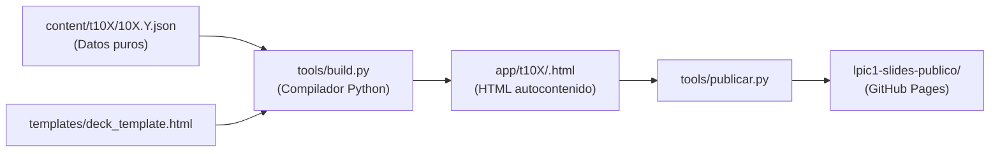

# Inventario del Material Legacy (`_legacy/`)

> **Informe de Solo Lectura y Auditoría Técnica**  
> Fecha: 2026-10-31 · Proyecto: LPIC-1 Study Guide · Fase 1 (Gate 1)

---

## 1. Mapa General de `_legacy/`

El material legado reside en la carpeta `_legacy/` (marcada como de solo lectura y excluida en `.gitignore`). Contiene dos grandes estructuras:

```
_legacy/
├── lpic1-slides-publico/          [10,46 MB · 89 archivos] (Sitio web compilado/publicado)
│   ├── index.html                 ← Portal de inicio publicado
│   ├── comandos.html              ← Cheatsheet global de 119 comandos
│   ├── glosario.html              ← Glosario interactivo de 116 términos
│   ├── erratas.html               ← Registro de 21 erratas del manual oficial
│   ├── grafo.html · mapa.html     ← Visor del grafo de conocimiento
│   ├── grafo/                     ← knowledge_graph.json (194 nodos, 302 aristas)
│   ├── simulador/                 ← index.html + preguntas_101.json (120) + preguntas_102.json (120)
│   ├── practicas/                 ← 23 prácticas de subtema + 4 globales de tema en HTML
│   └── t101/ .. t104/             ← 23 archivos HTML autocontenidos de diapositivas + 4 repasos
│
└── Recurso Final Definitivo/      [303,81 MB · 3.463 archivos] (Workspace fuente y herramientas)
    ├── content/                   ← ¡FUENTE LIMPIA! 52 archivos JSON estructurados (t101 a t110)
    ├── practicas-v2/              ← 70 archivos Markdown limpios de prácticas guiadas
    ├── tools/                     ← Compiladores Python (build.py, publicar.py, auditorías)
    ├── templates/                 ← Plantillas HTML (deck_template.html)
    ├── state/                     ← Metadatos maestros (subtopics_master.json, inventario, erratas)
    ├── auditoria/ · scratch/      ← Informes y pruebas intermedias
    └── Formación LPIC-1/          ← Manuales PDF oficiales del LPI (101-500 y 102-500)
```

### Distribución de Archivos por Extensión en `Recurso Final Definitivo`
- `.png`: 1.867 archivos (capturas de terminal de validaciones y preflight)
- `.txt`: 579 archivos (salidas de comandos y logs)
- `.md`: 364 archivos (prácticas, borradores y documentación de estado)
- `.py`: 317 archivos (scripts de generación, validación y auditoría)
- `.html`: 134 archivos (previsualizaciones compiladas)
- `.json`: 98 archivos (definición de diapositivas y esquemas de subtemas)
- `.pdf`: 48 archivos (manuales oficiales y temas desglosados)
- Carpetas prescindibles para la importación: `__pycache__`, `scratch/`, `capturas_*/` (solo evidencias de tests antiguos).

---

## 2. Pipeline de Generación del Legacy

El recurso público no se programó a mano en HTML, sino mediante un pipeline en Python:



- **Entrada principal**: Archivos `content/t<tema>/<subtema>.json` que contienen un objeto con `META` (tema, peso, título, descripción, duración) y `SLIDES` (un array con todas las diapositivas estructuradas).
- **Proceso (`tools/build.py`)**: Inyecta los datos JSON en la plantilla `templates/deck_template.html`, generando un HTML autocontenido con reproductor integrado en JavaScript vanilla (soporte de teclado, miniaturas, notas y modo oscuro).
- **Salida**: Se publicaba en `app/` y se sincronizaba a `lpic1-slides-publico/` mediante `tools/publicar.py`.

---

## 3. Inventario Detallado por Tipo de Contenido

### 3.1 Diapositivas de Lecciones
- **Ubicación en fuente**: `_legacy/Recurso Final Definitivo/content/t<tema>/<subtema>.json`
- **Ubicación en compilado**: `_legacy/lpic1-slides-publico/t<tema>/<slug>.html`
- **Formato real**: JSON tipado con bloques en fuente; HTML autocontenido con JavaScript en compilado.
- **Ejemplos reales**:
  1. `_legacy/Recurso Final Definitivo/content/t101/101.1.json` (19 diapositivas, peso 2).
  2. `_legacy/Recurso Final Definitivo/content/t103/103.4.json` (19 diapositivas, peso 4).
- **Estructura interna**: Cada diapositiva contiene `id`, `type` (`cover`, `diagram`, `concept`, `commands`, `config_file`, `challenge`, `review`, `flashcards`, `summary`), `notes` (notas del instructor), `ref` (páginas del manual oficial), y en diagramas `diagram_html` con SVG/HTML vectoriales.

### 3.2 Prácticas de Laboratorio
- **Ubicación en fuente**: `_legacy/Recurso Final Definitivo/practicas-v2/`
- **Ubicación en compilado**: `_legacy/lpic1-slides-publico/practicas/`
- **Formato real**: Markdown con metadatos estructurados (duración, dificultad, snapshot) y misiones paso a paso.
- **Ejemplos reales**:
  1. `_legacy/Recurso Final Definitivo/practicas-v2/p-103-4-redirecciones-tuberias.md` (30 min, básico, 2 misiones guiadas + reto).
  2. `_legacy/Recurso Final Definitivo/practicas-v2/p-tema-103-global.md` (misión integradora global del Tema 103).

### 3.3 Comandos y Cheatsheet
- **Ubicación en compilado**: `_legacy/lpic1-slides-publico/comandos.html`
- **Formato real**: Tabla HTML semántica con 119 filas (`tr.cmd-row`).
- **Ejemplos reales**:
  1. `lspci`: `lspci -nnk -s 00:02.0`, opciones `-k`, `-v`, `-s`, `-d`, `-nn`, `-t`, enlace a diapositiva 5 de 101.1.
  2. `tee`: `tee -a log.txt`, opciones `-a`, `-i`, enlace a diapositiva 11 de 103.4.

### 3.4 Glosario de Términos
- **Ubicación en compilado**: `_legacy/lpic1-slides-publico/glosario.html`
- **Formato real**: 116 tarjetas `.term-card` organizadas por tema y subtema con definición técnica y enlace a diapositiva.
- **Ejemplos reales**:
  1. `PCI`: Peripheral Component Interconnect (101.1 p. 5).
  2. `noclobber`: Opción de shell `set -o noclobber` que previene sobrescritura accidental (103.4 p. 8).

### 3.5 Preguntas del Simulador
- **Ubicación en compilado**: `_legacy/lpic1-slides-publico/simulador/preguntas_101.json` y `preguntas_102.json`
- **Formato real**: JSON estructurado con `id`, `tema`, `stem` (enunciado en inglés estilo examen LPI), `type` (`single`, `multiple`, `fill`), `options`, `correct_indices`, `fill_answers` y `explanation` (explicación detallada en español con citas al manual).
- **Ejemplos reales**:
  1. Pregunta 1 del Examen 101: `mkfs` sin parámetros por defecto ext2 (explicación citando `man 8 mkfs`).
  2. Pregunta 1 del Examen 102: comando para definir hostname (`hostname` / `hostnamectl`).

### 3.6 Fe de Erratas y Avisos de Examen
- **Ubicación en compilado**: `_legacy/lpic1-slides-publico/erratas.html`
- **Formato real**: 21 tarjetas `.errata-card` con ID (`E-001` a `E-021`), página del manual, error del texto oficial, realidad en Linux y consejo para el examen.
- **Ejemplos reales**:
  1. `E-001`: Manual pág. 13 confunde `/dev/fdO` con `/dev/fd0`.
  2. `E-007`: Confusiones de sintaxis en `systemctl` y `init`.

### 3.7 Grafo de Conocimiento / Mapa Mental
- **Ubicación en compilado**: `_legacy/lpic1-slides-publico/grafo/knowledge_graph.json`
- **Formato real**: JSON con `metadata`, `nodes` (194 nodos de tipo `topic`, `subtopic`, `command`, `concept`) y `edges` (302 conexiones con relaciones tipo `belongs_to`, `uses`, `relates_to`).

---

## 4. Análisis Técnico de las Diapositivas

- **Lienzo lógico**: Formato 16:9 optimizado para 1280×720 con escalado dinámico.
- **Nivel de aislamiento**: Cada HTML de `lpic1-slides-publico` es completamente autocontenido (estilos CSS inline, SVG embebidos sin dependencias externas ni CDN).
- **Texto**: 100 % texto seleccionable en DOM (sin texto incrustado en mapas de bits).
- **Diagramas**: Diseñados en flexbox y CSS nativo con tarjetas de colores y flechas vectoriales (`diagram_html`).
- **Peso medio**: ~200 kB por subtema compilado; ~70 kB en JSON fuente.
- **¿Es viable `<iframe sandbox>`?**: Sí, los HTML compilados funcionan aislados, pero un iframe bloquea la búsqueda profunda, la vista Web responsive continua y la generación de PDF.
- **¿Es viable el parsing nativo?**: **Mucho mejor y más fácil**, porque disponemos de los archivos fuente `10X.Y.json` sin necesidad de desensamblar HTML.

---

## 5. Recuento Real vs Esperado

| Tipo de Contenido | Cifra Estimada (`07-curriculo.md`) | Recuento Real en `_legacy/` | Discrepancia / Explicación |
|---|---|---|---|
| **Subtemas Examen 101** | 23 | **23** | Coincidencia exacta (101.1 a 104.7) |
| **Subtemas Examen 102** | 0 (planificado) | **19** | **¡EXISTEN!** En `content/` están t105 a t110 completos |
| **Diapositivas Examen 101** | 437 | **436 (+ 105 repaso)** | 436 de subtemas + 105 diapositivas de repaso gráfico = 541 |
| **Diapositivas Examen 102** | 0 | **311 (+ 105 repaso)** | 311 de subtemas + 105 de repaso gráfico = 416 |
| **Prácticas Examen 101** | 27 (23 + 4) | **27** | 23 de subtemas + 4 globales de tema |
| **Prácticas Examen 102** | 0 | **25 (19 + 6)** | 19 de subtemas + 6 globales de tema (+ 15 P01–P15) |
| **Comandos registrados** | 126 | **119** | 119 en `comandos.html` (los otros 7 son variantes de flags) |
| **Términos de glosario** | 116 | **116** | Coincidencia exacta |
| **Preguntas simulador 101** | 120 | **120** | Coincidencia exacta |
| **Preguntas simulador 102** | 0 | **120** | **¡EXISTEN!** 120 preguntas listas en `preguntas_102.json` |
| **Erratas del manual** | 21 | **21** | Coincidencia exacta (`E-001` a `E-021`) |
| **Nodos del mapa mental** | 475 | **194 nodos / 302 aristas** | La cifra 475 era la suma aproximada de nodos (194) + aristas (302) = 496 |

---

## 6. Hallazgos Clave e Inconsistencias Detectadas

1. **El Examen 102 NO está vacío en el legado**: A diferencia de lo previsto en `07-curriculo.md` (que lo marcaba como mero placeholder sin diapositivas ni preguntas), en `_legacy/Recurso Final Definitivo/content/` y `simulador/` **ya existen las diapositivas de los 19 subtemas (t105 a t110), sus prácticas y 120 preguntas de examen**.
2. **Fuente JSON extremadamente limpia**: No dependemos de scrapear HTML compilado. Los archivos `content/t10X/10X.Y.json` son fuentes canónicas, versionables y limpias.
3. **Erratas de tipografía en títulos legacy**: Algunos archivos tienen caracteres UTF-8 sustituidos por `` en comentarios y metadatos secundarios (p. ej. "duracin"), pero el contenido técnico y los comandos están íntegros.
4. **Relaciones cruzadas explícitas**: Cada comando en `comandos.html` y cada término en `glosario.html` tiene un ancla clara al subtema y a la diapositiva correspondiente (ej. `t101/101-1-determinar-y-configurar.html#/5`).

---

## 7. Evaluación de Estrategias de Importación

### Estrategia A · Conversión 100% a Markdown/Bloques Nativos
- **Descripción**: Transformar cada diapositiva en un documento Markdown extendido o YAML nativo, sustituyendo los diagramas HTML por sintaxis de bloques o Mermaid/SVG puro.
- **Pros**: Máxima integración con el buscador MiniSearch, vista web y exportación PDF nativa. 0 dependencias heredadas.
- **Contras**: Pérdida potencial de la riqueza visual original de los diagramas complejos de `diagram_html`. Alto esfuerzo de conversión manual/heurística.
- **Esfuerzo**: **L (Grande)** · **Riesgo**: Medio-Alto.

### Estrategia B · Incrustar Diapositivas HTML en `<iframe>`
- **Descripción**: Copiar los 23 archivos HTML de `lpic1-slides-publico` a `public/legacy-slides/` e incrustarlos dentro de un `iframe` escalado en `/estudiar/:subtema`.
- **Pros**: 100% fidelidad visual inmediata sin esfuerzo de maquetación; esfuerzo mínimo.
- **Contras**: La vista Web continua y la exportación PDF quedan bloqueadas o degradadas. El buscador no puede resaltar términos dentro de un iframe sin comunicación postMessage compleja. Duplicación de estilos.
- **Esfuerzo**: **S (Pequeño)** · **Riesgo**: Alto para la arquitectura SPA y requisitos de Gates 5 y 6.

### Estrategia C (Recomendada) · Enfoque Híbrido Estructurado desde `content/*.json`
- **Descripción**:
  1. Utilizar los archivos fuente `content/t10X/10X.Y.json` como origen directo (no el HTML sucio).
  2. Parsear el JSON hacia los modelos de dominio Angular (`Lesson`, `Slide`, `Block`).
  3. Renderizar las diapositivas mediante el visor de Angular: el texto, código, tablas, listas y retos se renderizan como componentes nativos OnPush; y las cajas de `diagram_html` se sanitizan con `DOMPurify` y se integran vectorialmente en la diapositiva.
  4. Extraer comandos y glosario a `content-src/commands.yaml` y `content-src/glossary.yaml` mediante un script reproducible en Node/TS.
- **Pros**:
  - Fidelidad visual del 100 % sin usar `iframe`.
  - El buscador indexa todos los textos, notas y códigos nativamente.
  - La vista Web (scroll continuo) y la vista PDF funcionan de manera directa a partir del mismo modelo de datos.
  - Scripts de importación reproducibles e idempotentes en Node/TypeScript.
- **Contras**: Requiere escribir el importador JSON → YAML/Markdown en la Fase 2 (ya previsto en el plan).
- **Esfuerzo**: **M (Medio)** · **Riesgo**: Mínimo.

---

## 8. Preguntas Abiertas para el Usuario

1. **¿Confirmas la adopción de la Estrategia C (Híbrida estructurada a partir de los JSON fuente de `content/`) para registrar la decisión D-004?**
2. **Sobre el Examen 102**: Dado que el material legado ya contiene los 19 subtemas, diapositivas y 120 preguntas de los Temas 105–110:
   - ¿Mantenemos el Examen 102 como "Planificado" para el MVP inicial y lo importamos en la Fase 11, o prefieres incorporar sus preguntas y diapositivas desde la Fase 2?
3. **Preguntas del Simulador**: Los enunciados de las preguntas están en inglés (el idioma oficial del examen de certificación LPI) y las explicaciones didácticas están en español. ¿Es este el comportamiento deseado para el simulador?
4. **Prácticas globales vs individuales**: Existen 23 prácticas de subtema y 4 prácticas globales de fin de tema para el 101. ¿Quieres que las prácticas globales se muestren al final de cada tema en la vista de temario y laboratorio?
5. **Diagramas**: ¿Confirmas que los diagramas HTML/SVG existentes en los JSON pueden renderizarse directamente dentro del visor de diapositivas sanitizados con `DOMPurify`?

