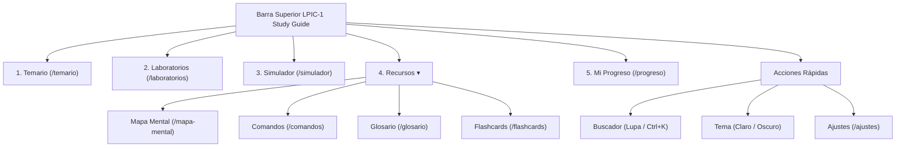
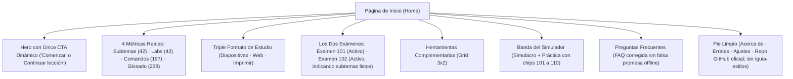

# Informe de Auditoría A2 · Navegación, Arquitectura de la Información y Copy

**Fecha:** 2026-11-03  
**Auditor:** Agente A2 (Navegación, arquitectura y copy)  
**Proyecto:** LPIC-1 Study Guide (`lpic1.manuelcobos.dev`)  
**Servidor analizado:** `http://localhost:4200`  
**Estado global:** CONFIRMADO · 15 hallazgos (3 P0, 4 P1, 8 P2)

---

## 1. Resumen Ejecutivo (10 líneas)

La navegación y la arquitectura de la información presentan una base funcional sólida, pero adolecen de enlaces rotos críticos y contradicciones de copy graves. Se han confirmado 3 fallos bloqueantes P0: enlaces a una ruta inexistente `/leccion` en la página de Fe de Erratas, un botón de reto integrador en los 10 temas que enlaza a laboratorios inexistentes (`/laboratorios/tema-X`) arrojando errores en tiempo de ejecución, y la miga de pan que conduce a un 404 al pulsar sobre el segmento virtual "Estudiar". En copy, la FAQ promete soporte offline sin contar con Service Worker (S-15), el README publicita cifras infladas e inexactas (S-03), y la Home bloquea artificialmente el Examen 102 con la etiqueta "Planificado para Fase 11" (S-12) pese a estar disponible en el catálogo. La cabecera desktop sufre saturación con 8 enlaces planos, el menú móvil degrada el buscador mostrando únicamente "Ctrl K", y el pie expone la guía interna de estilos en producción (S-11).

---

## 2. Metodología y Alcance Verificado

- **Rastreo estático exhaustivo:** Escaneo automático de los 131 enlaces `routerLink` y 9 `href` en `src/`, y de los 42 subtemas, comandos y glosario en `content-src/` mediante scripts Node/TS dedicados en `docs/agent/auditorias/web-2026-11-03/scripts/`.
- **Verificación funcional end-to-end con Playwright:** Ejecución de pruebas automatizadas sobre `http://localhost:4200` validando resolución de URLs, respuestas HTTP/SPA, captura de DOM en viewports de 1920×1080 (escritorio) y 390×844 (móvil).
- **Inspección de copy y ortografía:** Auditoría de tuteo vs usted, detección de términos sin tilde, concordancia de marca e inventario de menciones residuales de desarrollo ("Fase N", "Próximamente").
- **Cotejo de datos oficiales:** Comparativa entre `public/content/manifest.json`, `README.md`, `home-page.component.ts` y especificaciones del LPI.

---

## 3. Matriz de Hallazgos

| ID | Sev. | Categoría | Título del hallazgo | Evidencia principal | Semilla | Estado |
|---|---|---|---|---|---|---|
| **A2-001** | **P0** | Navegación | Enlaces rotos en Fe de Erratas: ruta `/leccion/:id` produce 404 | `errata-page.component.html:164` | — | CONFIRMADO |
| **A2-002** | **P0** | Navegación | Reto integrador enlaza a lab inexistente (`/laboratorios/tema-101`) | `topic-detail-page.component.ts:210` | — | CONFIRMADO |
| **A2-003** | **P0** | Navegación | Miga de pan genera enlace roto a `/estudiar` (404) | `breadcrumbs.component.ts:60-68` | S-09 | CONFIRMADO |
| **A2-004** | **P1** | Navegación | Enlaces de catálogo en wiki-popover escapan query (`/comandos%3Fq=...`) | `wiki-popover.component.ts:90` | — | CONFIRMADO |
| **A2-005** | **P1** | Contenido | Falsa promesa de soporte offline en la FAQ de la Home | `home-page.component.ts:975-978` | S-15 | CONFIRMADO |
| **A2-006** | **P1** | Contenido | Jerga interna "Fase 11" y Examen 102 bloqueado artificialmente | `home-page.component.ts:243,266` | S-12 | CONFIRMADO |
| **A2-007** | **P1** | Contenido | Cifras públicas infladas y desincronizadas en README y Home | `README.md:15-35`, `home-page.ts:1039` | S-03 | CONFIRMADO |
| **A2-008** | **P2** | Navegación | Breadcrumbs muestra slugs sin formatear con guiones (`Mapa-mental`) | `breadcrumbs.component.ts:63` | S-09 | CONFIRMADO |
| **A2-009** | **P2** | Navegación | Cabecera saturada (8 enlaces) y botón "Ctrl K" inútil en móvil | `header.component.ts:36-77, 88` | S-09 | CONFIRMADO |
| **A2-010** | **P2** | Navegación | Triple CTA al simulador y tarjetas métricas redundantes en la Home | `home-page.component.ts:67,132,404` | S-11 | CONFIRMADO |
| **A2-011** | **P2** | Navegación | Exposición de `/guia-estilos` en pie de producción y páginas huérfanas | `footer.component.ts:24` | S-11, S-12 | CONFIRMADO |
| **A2-012** | **P2** | Contenido | Inconsistencia de marca: "LPIC-1 Aula" vs "LPIC-1 Study Guide" | `header.component.ts:32`, `app.routes.ts:9` | — | CONFIRMADO |
| **A2-013** | **P2** | Contenido | URLs ficticias de GitHub (`usuario/lpic-1-study-guide`) en Erratas y README | `errata-page.component.ts:32`, `README.md:68` | S-16 | CONFIRMADO |
| **A2-014** | **P2** | Navegación | Cajón del mapa mental enlaza temas y exámenes a `/temario` genérico | `mind-map-page.component.html:328` | — | CONFIRMADO |
| **A2-015** | **P2** | Navegación | Términos autovinculados en visor de diapositivas carecen de evento click | `slide-viewer.component.ts:515-555` | — | CONFIRMADO |

---

## 4. Análisis Detallado de Hallazgos

### 4.1. Enlaces Rotos y Rutas Inválidas (P0 / P1)

1. **Ruta inexistente `/leccion` en Fe de Erratas (A2-001 · P0):**  
   En `errata-page.component.html:164`, cada incidencia reportada enlaza con `[routerLink]="['/leccion', item.subtopicId]"`. La ruta canónica en `app.routes.ts` es `estudiar/:subtema`. Al pulsar sobre cualquier errata en `http://localhost:4200/erratas`, la URL pasa a `/leccion/103.4`, cayendo en el comodín 404.

2. **Falso laboratorio integrador por tema (A2-002 · P0):**  
   En `topic-detail-page.component.ts:210`, la tarjeta "🏆 Reto Global" de cada tema enlaza a `['/laboratorios', 'tema-' + topic.id]`. En el catálogo de datos no existe ningún fichero `lab-tema-101.json` (solo existen prácticas `lab-101-1.json`, etc.). La llamada fetch a `/content/labs/lab-tema-101.json` recibe el fallback `index.html`, arrojando un error de sintaxis JSON y dejando al usuario con una pantalla de error en los 10 temas.

3. **Miga de pan a ruta virtual `/estudiar` (A2-003 · P0):**  
   `BreadcrumbsComponent` genera migas basadas en segmentos de la URL. Al estar en `/estudiar/105.1`, genera el enlace acumulado `/estudiar`. Dado que `app.routes.ts` solo admite `estudiar/:subtema`, hacer clic en "Estudiar" produce un 404 inmediato.

4. **Malformación de URLs con query params en popovers (A2-004 · P1):**  
   En `wiki-popover.component.ts:90`, el enlace hacia el catálogo completo utiliza `[routerLink]="item.link"`, donde `item.link` es una cadena con query params (ej. `/comandos?q=source`). Angular RouterLink codifica `?` e `=` como entidades URL (`/comandos%3Fq%3Dsource`), navegando a una ruta errónea que activa la pantalla de 404.

### 4.2. Copy, Promesas y Veracidad Técnica (P1 / P2)

1. **Falso soporte offline en la FAQ (A2-005 · P1 / Semilla S-15):**  
   La FAQ3 asegura que *"todos los contenidos, lecciones teóricas, comandos y preguntas quedan en caché en el navegador para permitir el estudio completo sin conexión"*. No existe Service Worker ni manifiesto PWA configurado. Sin conexión, la aplicación no carga recursos externos ni reanuda rutas profundas.

2. **Jerga interna "Fase 11" y Examen 102 bloqueado (A2-006 · P1 / Semilla S-12):**  
   La Home muestra la tarjeta del Examen 102 con badge "Próximamente", texto "Planificado para Fase 11" y botón bloqueado. En contraste, el catálogo `manifest.json` lo define como `available`, la lección `105.1` cuenta con diapositivas completas y el examen puede cursarse en `/temario/102`. Las rutas en `app.routes.ts` arrastran metadatos obsoletos `phase: 'Fase N'`.

3. **Discrepancia de métricas entre README, Home y Manifiesto (A2-007 · P1 / Semilla S-03):**  
   El README anuncia 770 diapositivas, 193 comandos y 230 términos bajo la premisa de "100% Cobertura Real, 0 Placeholders". El manifiesto real suma 771 diapositivas, 197 comandos y 238 términos. Además, la fórmula en `home-page.component.ts:1039` suma placeholders a las diapositivas reales, enmascarando el avance real.

4. **Identidad de marca fragmentada (A2-012 · P2):**  
   Conviven dos nombres oficiales en la misma web: "LPIC-1 Aula" (navbar, about, backup) y "LPIC-1 Study Guide" (títulos de pestaña, visor de diapositivas, impresión, README).

5. **URLs ficticias de GitHub (A2-013 · P2 / Semilla S-16):**  
   Tanto en Erratas como en README se enlaza al repositorio marcador `https://github.com/usuario/lpic-1-study-guide`, que devuelve 404 en GitHub.

### 4.3. Navegación, Header y Experiencia Móvil (P2)

1. **Miga de pan con slugs crudos (A2-008 · P2 / Semilla S-09):**  
   Segmentos como `/mapa-mental` o `/guia-estilos` se muestran como `Mapa-mental` y `Guia-estilos` al no transformar guiones en espacios ni leer `data.breadcrumb`.

2. **Cabecera sobresaturada y tecla "Ctrl K" en móvil (A2-009 · P2 / Semilla S-09):**  
   8 enlaces planos en la barra superior provocan congestión entre 768px y 1280px. A menos de 640px, el botón de búsqueda solo muestra `<kbd>Ctrl K</kbd>`, inutilizable en smartphones. El menú hamburguesa omite Buscar y Ajustes.

3. **Arquitectura redundante de llamadas a la acción en la Home (A2-010 · P2 / Semilla S-11):**  
   El usuario se encuentra con 3 bloques que conducen al simulador. En las métricas, dos tarjetas independientes ("Diapositivas" y "Subtemas") enlazan exactamente a la misma pantalla `/temario`.

4. **Exposición pública de `/guia-estilos` y código muerto (A2-011 · P2 / Semilla S-11, S-12):**  
   El footer expone un enlace a la guía de componentes de diseño. La página `NotImplementedPageComponent` no está enrutada y permanece como residuo en el repositorio.

5. **Pérdida de contexto en el Mapa Mental (A2-014 · P2):**  
   Al pulsar sobre un tema o examen en el drawer del mapa mental, el botón lleva a `/temario` genérico en vez de a `/temario/:examen/:tema`.

6. **Autolinks en visor de diapositivas sin clic táctil (A2-015 · P2):**  
   El visor carece de manejador `click` en los términos wiki. En móvil o táctil, tocar un comando navega directamente a `/comandos` en lugar de abrir el popover explicativo.

---

## 5. Propuesta de Mapa de Navegación Objetivo

### 5.1. Cabecera (Header) Reorganizada

Reducir la barra superior de 8 enlaces planos a **3 accesos formativos + 1 menú de recursos + 1 acceso de progreso personal**:

- **En móvil (<768px):**  
  - Botón de búsqueda: muestra exclusivamente icono de lupa (sin etiqueta `Ctrl K`).
  - Menú hamburguesa: agrupa los enlaces en bloques temáticos (*Estudio*, *Herramientas de Consulta*, *Configuración e Información* incluyendo Ajustes, Erratas y Acerca de).
  - Añade `aria-expanded` y cierre con tecla Escape o clic fuera.

### 5.2. Estructura de la Home Saneada

- **Limpieza de redundancias en Home:**
  - Retirar el botón secundario del Hero ("Simulador de examen"), dejando el Hero enfocado 100% al inicio/reanudación del temario.
  - Eliminar la tarjeta métrica redundante de "Diapositivas" que duplicaba el enlace a `/temario`.
  - Desbloquear la tarjeta de Examen 102 permitiendo navegar a `/temario/102`, explicitando el estado de cobertura real de cada subtema.
  - Ampliar los chips de la banda del simulador para que abarquen los temas 101 al 110.

### 5.3. Jerarquía Semántica de Breadcrumbs

Sustituir la generación ingenua por segmentos de URL por un árbol jerárquico consciente:
- `/` → *Inicio*
- `/temario` → *Inicio > Temario*
- `/temario/101` → *Inicio > Temario > Examen 101*
- `/temario/101/101` → *Inicio > Temario > Examen 101 > Tema 101*
- `/estudiar/105.1` → *Inicio > Temario > Examen 102 > Tema 105 > Subtema 105.1*
- `/laboratorios/lab-101-1` → *Inicio > Laboratorios > Práctica 101.1*
- Rutas sin sub-recorrido (`/mapa-mental`, `/acerca-de`) → transformar guiones en espacios legibles con tildes.

---

## 6. Qué NO se Pudo Comprobar (Límites de la Auditoría)

1. **Service Worker en entornos de producción HTTPS:** Se confirmó en código que no existe configuración de PWA ni Service Worker (`ngsw-worker.js` ausente). No se probó el comportamiento bajo CDN Cloudflare Pages en caso de que aplicara cabeceras especiales de caché estático.
2. **Navegadores móviles físicos antiguos:** Las pruebas táctiles se realizaron mediante emulación de Playwright (Chromium mobile viewport 390×844). Se recomienda verificar manualmente en Safari iOS y Chrome Android los gestos de deslizamiento en diapositivas.
3. **Validación semántica de enlaces externos en material de estudio:** Los enlaces externos a documentación (`man7.org`, `kernel.org`, `debian.org`) se escanearon para comprobar formato, pero no se realizó un barrido de peticiones HTTP en vivo para evitar rate limits o bloqueos por parte de servidores de terceros.
4. **Coordinación cruzada de contenidos con A4/A5:** Las discrepancias entre `103.8.json` (comandos `i` y `x` de vi no indexados en `commands.yaml`) se delegan al informe de integridad de contenido (A4) y técnica LPI (A5).

---
*Fin del informe del Agente A2.*
